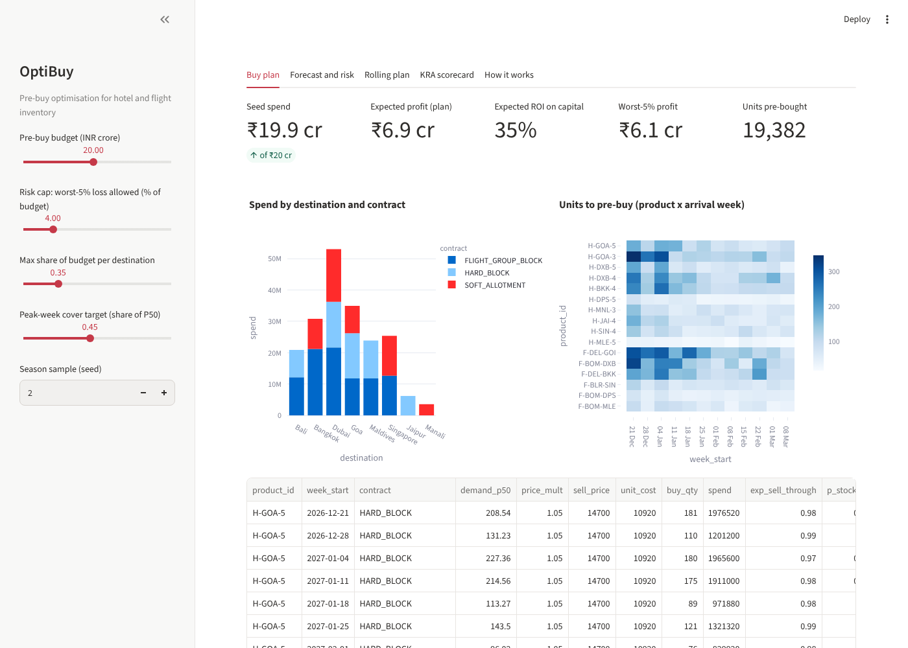
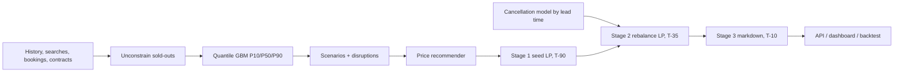
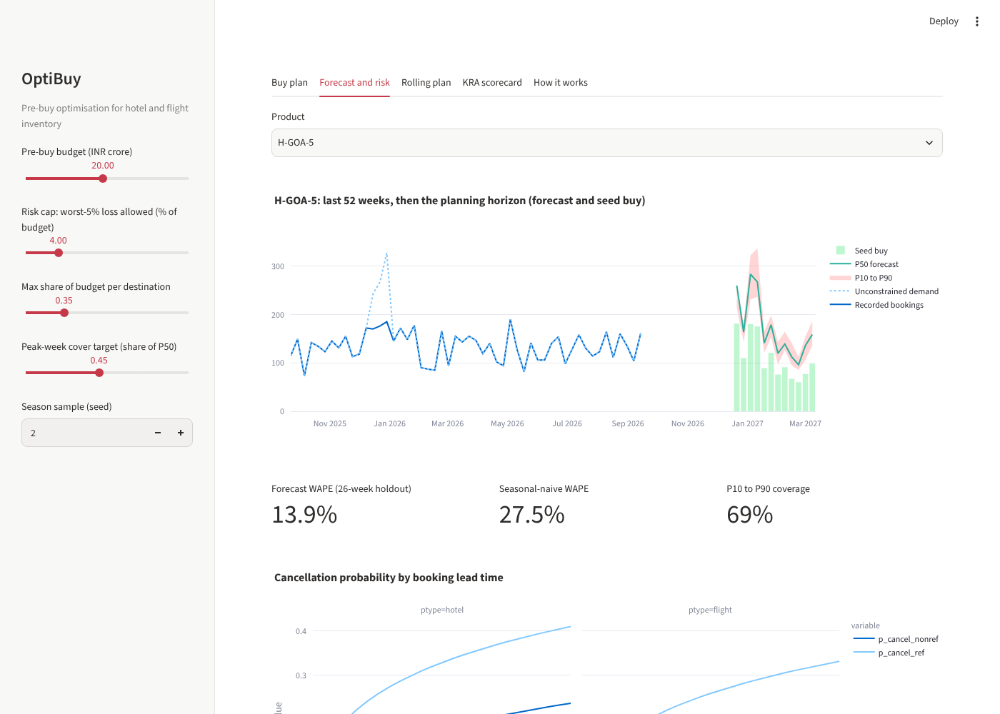
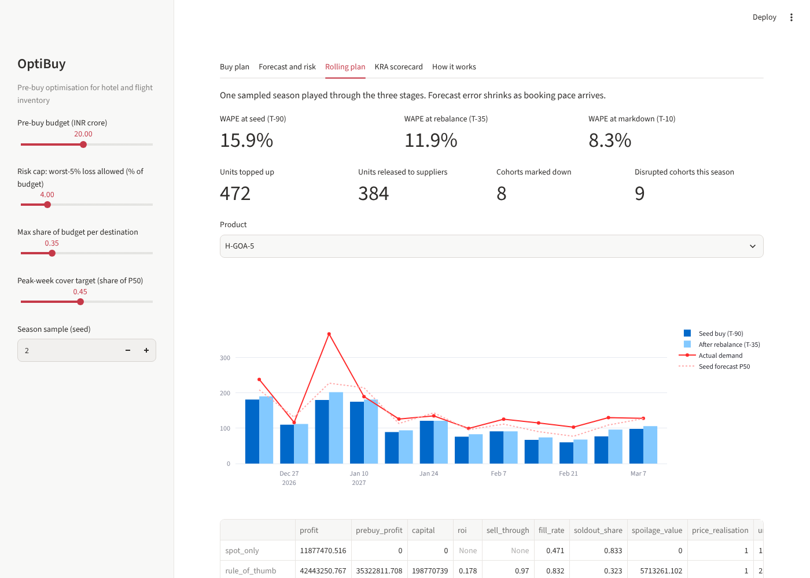

# OptiBuy: automated inventory pre-buy for TBO

**TBO VoyageHack 4.0 · Case: Automate Inventory Optimization · Round 2 prototype**

OptiBuy decides **what** hotel rooms and flight seats TBO should buy in advance, **how many**,
**when**, and **at what sell price**, inside a fixed budget, while keeping the risk of unsold stock
under control. It does this as a **three-stage rolling plan**: a discounted seed buy about 90 days
out, a rebalance on live booking pace before supplier release deadlines, and a markdown/release
pass close to arrival.



## Results on the simulated benchmark

20 sampled seasons (Dec to Mar peak), budget ₹20 crore, 16 products x 12 arrival weeks.
Every policy faces the same seasons. Full table: [`reports/kpi_summary.md`](reports/kpi_summary.md).

| Policy | Profit (₹ cr) | Worst-5% profit (₹ cr) | ROI on capital | Demand served | Sold-out cohorts | Spoilage (₹ cr) |
|---|---|---|---|---|---|---|
| Spot only (no pre-buy) | 1.16 | 1.13 | n/a | 45.3% | 82.8% | 0.00 |
| Rule of thumb (80% of last year, hard blocks) | 4.58 | 4.10 | 19.4% | 83.1% | 36.1% | 0.32 |
| OptiBuy, seed stage only | 6.66 | 5.74 | 28.9% | 96.6% | 11.5% | 0.55 |
| **OptiBuy, full rolling plan** | **6.91** | **6.20** | **29.5%** | **97.0%** | **11.0%** | **0.29** |

Against the rule of thumb on the same budget: **+51% profit, +10 points ROI, sold-out cohorts down
from 36% to 11%, worst-case season up 51%**. The rebalance and markdown stages halve spoilage
compared with buying once and holding. Forecast WAPE is **13.9%** on a 26-week holdout versus
27.5% for a seasonal naive forecast, and falls from 15.7% at T-90 to 11.6% at T-35 and 8.4% at
T-10 as booking pace comes in.

> These numbers come from a synthetic world built to mimic the structure of TBO's problem
> (censored history, correlated destination shocks, disruptions, contract terms, scarce spot
> supply in peaks). They show the method works and how much each stage adds; they are not a
> forecast of TBO's actual P&L. Re-run them with `python scripts/run_backtest.py`.

## How it maps to the case

| The case asks | OptiBuy |
|---|---|
| Use historical bookings, demand trends, sold-outs, look-to-book, seasonality, external signals | Sold-out weeks are **unconstrained** with searches x conversion; features include seasonality, festival calendar, destination peaks, last year, and early **search volume** as a look-to-book leading indicator |
| Decide **what** to pre-buy (hotels, flights, destinations, periods) | One LP over every product x arrival week, hotels and flight blocks together, with destination concentration limits |
| Decide **how much** | Scenario LP maximising expected profit minus λ(t)·CVaR95, with contract-specific release and salvage value |
| Decide **when** | Seed at T-90 (deepest discount), top-up or release at T-35 (before release deadlines), markdown at T-10 |
| Decide **at what price** | Elasticity-aware price recommendation per unit; markdown grid at T-10 |
| Within a **maximum budget** | Hard budget constraint; releases recycle capital into top-ups |
| Risks: demand swings, price changes, cancellations, unsold stock | Correlated demand scenarios and disruptions; price elasticity; **lead-time-dependent cancellation model** used on booking pace; CVaR risk cap; release options; markdowns |

## KRAs we track

| KRA | Metric in this repo |
|---|---|
| Forecast accuracy | WAPE vs actual demand at T-90, T-35, T-10; holdout WAPE vs seasonal naive; P10 to P90 coverage |
| Availability | Demand served (fill rate) and share of sold-out product-weeks |
| Sell-through | Pre-bought units sold / units held at arrival |
| Return on budget | Pre-buy profit / capital deployed; profit uplift vs spot-only |
| Risk control | Worst-5% season profit (CVaR), spoilage value of unsold stock |
| Pricing accuracy | Price realisation: revenue / units sold at the recommended price |
| Adoption | Analyst dashboard with explainable outputs (slacks say which policy gave way); API for integration; human approval of the plan |

## Architecture



Details: [`docs/architecture.md`](docs/architecture.md) · method: [`docs/approach.md`](docs/approach.md)

### The optimisation model

For units *i* (product x arrival week) and scenarios *k*:

```
max  E_k[profit_k] − λ(t)·CVaR95(−profit) − penalties·slacks

profit_k = Σ_i  p_i·s_ik + m_i·y_ik + rec_ik − c_i·x_i + v_i·rel_i
s_ik ≤ H_i + x_i − rel_i            sell from own stock
s_ik + y_ik ≤ D_ik,  y_ik ≤ Spot_ik  overflow served on request at thin margin m_i
rec_ik ≤ release/salvage value of unsold units (concave, by contract type)
Σ c_i·x_i − v_i·rel_i ≤ Budget                  hard
CVaR95(loss) ≤ risk cap + slack                  soft
spend per destination ≤ 35% budget + slack       soft
holdings ≥ peak cover target − slack             soft
λ(t) = λ0 + λ1·exp(−t/τ),  t = days to arrival at the re-plan
```

Hard constraints are only the ones that can never conflict (budget, supplier caps), so the model
always returns a plan; slack values report which business rule had to bend.

### Supplier contract types

| Contract | Cost vs market | Release terms | Unsold at arrival |
|---|---|---|---|
| `HARD_BLOCK` (prepaid hotel) | 78% | none | 15% salvage |
| `SOFT_ALLOTMENT` (hotel) | 86% | 100% releasable until 28 days out, 5% fee | 15% salvage |
| `FLIGHT_GROUP_BLOCK` | 83% | 20% free attrition until 30 days out | 10% salvage |
| Spot / on request | 94% | n/a | scarce in peak weeks |

## Quick start

```bash
git clone https://github.com/VisheshS-04/optibuy-tbo-voyagehack.git
cd optibuy-tbo-voyagehack
python -m venv .venv && source .venv/bin/activate   # Windows: .venv\Scripts\activate
pip install -r requirements.txt

pytest -q                                  # 8 tests, ~15 s
streamlit run dashboard/app.py             # analyst dashboard at http://localhost:8501
uvicorn api.main:app --reload              # REST API, docs at http://127.0.0.1:8000/docs
python scripts/run_backtest.py --sims 20   # KRA scorecard to reports/ (~5 min)
```

Python 3.11+. No GPU, no paid solver: the LP uses HiGHS through SciPy.

### API

| Method | Path | What it returns |
|---|---|---|
| GET | `/health` | liveness |
| GET | `/catalog` | products and contract types |
| GET | `/forecast?seed=1` | P10/P50/P90 for every product x arrival week |
| GET | `/forecast/backtest` | holdout WAPE vs seasonal naive, interval coverage |
| GET | `/cancellation/curves` | cancellation probability and pace curves by lead time |
| POST | `/plan` | seed buy plan + summary (spend, expected profit, CVaR, slacks) |
| POST | `/simulate` | KRA comparison of OptiBuy vs baselines over sampled seasons |

```bash
curl -X POST localhost:8000/plan -H 'content-type: application/json' \
     -d '{"budget": 200000000, "risk_cap_pct": 0.04, "max_dest_share": 0.35}'
```

### Dashboard

| Buy plan | Forecast and risk | Rolling plan |
|---|---|---|
|  |  |  |

Sidebar controls: budget, risk cap, destination concentration, peak-week cover. Tabs: buy plan,
forecast with P10 to P90 band and cancellation curves, the rolling plan for one season, a KRA
scorecard that simulates many seasons, and a plain-language explanation.

## Repository layout

```
optibuy/            core library
  config.py         catalogue, contract types, policy knobs, λ(t)
  data.py           synthetic world generator (swap for real loaders)
  forecast.py       unconstraining, quantile GBM, scenarios, WAPE
  cancellation.py   lead-time cancellation model, pace curves
  optimizer.py      scenario LP with CVaR and soft constraints
  planner.py        pricing, seed / rebalance / markdown, baselines, simulator
api/main.py         FastAPI service
dashboard/app.py    Streamlit analyst UI
scripts/            backtest runner
reports/            generated KRA scorecard
docs/               architecture, method, screenshots
tests/              unit and API tests
```

## Feasibility and adoption

* **Runs on commodity hardware.** The seed LP for 192 units x 80 scenarios (about 47k variables)
  solves in seconds on a laptop with open-source HiGHS.
* **Same data TBO already has.** Bookings, searches, sold-out flags, cancellations and supplier
  contract terms. `optibuy/data.py` is the only file to replace.
* **Human in the loop.** The plan is a recommendation with expected sell-through, stock-out risk
  and the reason any rule was relaxed; buyers approve, edit or reject it.
* **Safe rollout.** Shadow mode first (plan alongside the buying team, compare outcomes), then
  one destination cluster, then scale.

## Limitations and next steps

* Synthetic data; elasticities, contract terms and disruption rates are assumptions to be
  calibrated on TBO data.
* Weekly granularity (room-nights per arrival week). Nightly length-of-stay effects are not modelled.
* Rebalancing for all cohorts is solved at each cohort's own T-35 as one joint problem; in
  production this becomes a nightly re-plan over open cohorts.
* Next: competitor rate feeds into pricing, supplier minimum-commitment terms (MILP), and
  per-agent demand segments.

---

Built for TBO VoyageHack 4.0 by team OptiBuy.
