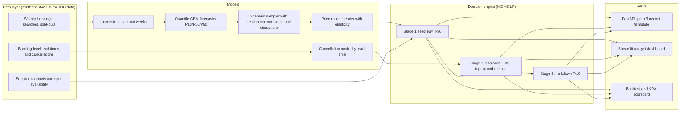

# Architecture

## Modules

| Path | Responsibility |
|---|---|
| `optibuy/config.py` | Product catalogue, contract types, policy knobs, λ(t) |
| `optibuy/data.py` | Synthetic world: demand process, censoring, searches, bookings, disruptions, spot capacity |
| `optibuy/forecast.py` | Unconstraining, features, quantile GBM, scenario sampler, WAPE backtest |
| `optibuy/cancellation.py` | Logistic cancellation model, pace curve, future-cancel rate |
| `optibuy/optimizer.py` | Scenario LP with CVaR, budget, soft constraints (scipy + HiGHS) |
| `optibuy/planner.py` | Pricing, three-stage rolling engine, baselines, season simulator |
| `api/main.py` | REST API |
| `dashboard/app.py` | Analyst UI |
| `scripts/run_backtest.py` | Monte Carlo KRA scorecard to `reports/` |

## Size and speed

16 products x 12 arrival weeks = 192 decision units. With 80 scenarios the seed LP has about
47,000 variables and 62,000 constraints and solves in 2 to 7 seconds on a laptop CPU. It scales
linearly in scenarios and units; at TBO scale the same model would run per region or per
destination cluster nightly, or switch to a commercial solver.

## Moving from synthetic to real data

Replace `optibuy/data.py` with loaders that return the same columns:

* weekly history: `product_id, week_start, bookings, searches, early_searches, sold_out`
* bookings: `ptype, lead_days, refundable, cancelled`
* supplier offers: market rate, contract type, block cap, release terms

Everything downstream keeps working unchanged.
